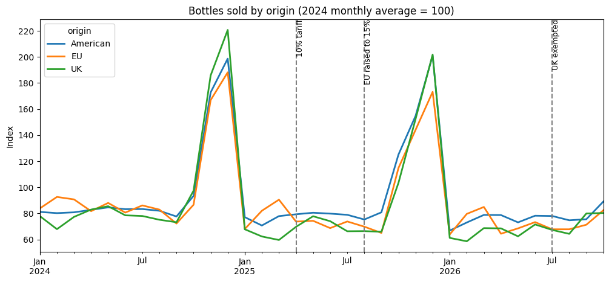
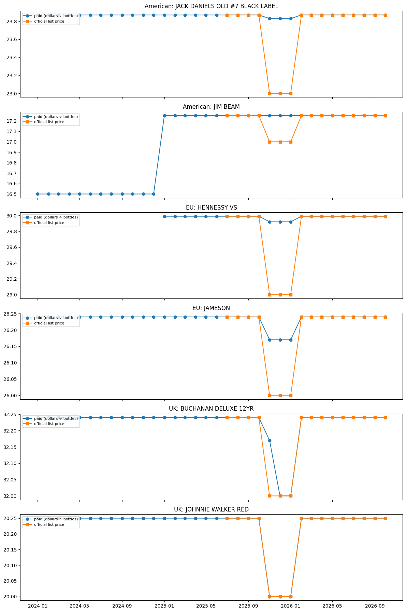
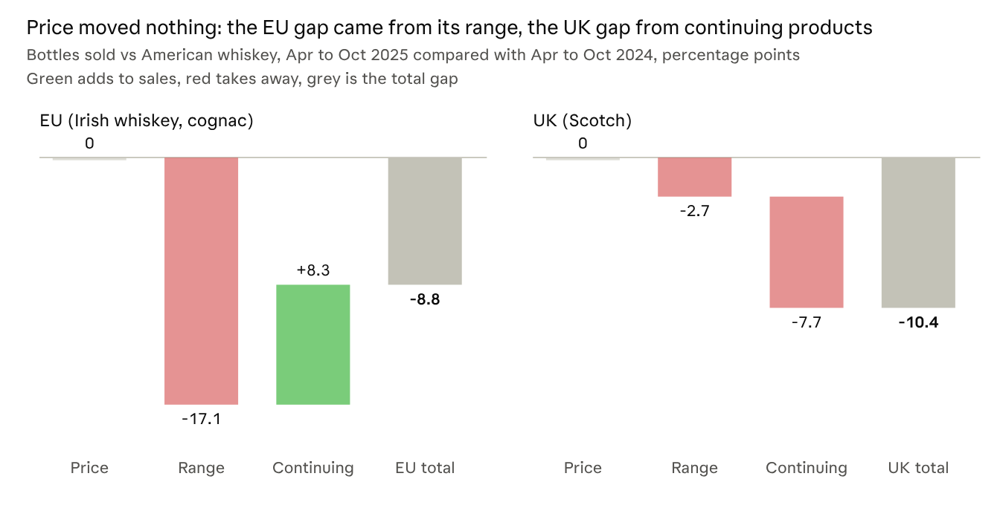

# Whiskey Tariffs in Iowa: Prices, Sales and Availability

After the 2025 US tariffs on European spirits, Iowa's wholesale prices for imported whiskey did not move, yet imported sales still fell 7 to 10 percentage points more than American whiskey. The decline came through availability (a narrower product range and fewer stores ordering), not through price.

## The question

The US placed a 10% tariff on UK and EU spirits in April 2025 and raised the EU rate to 15% in August 2025. Did import prices rise, did sales fall, and if so, why?

The project started from a classic pricing case: a company expects a price increase to bring in more revenue, gets less, and has to explain the gap through price, volume and mix.

## Data

[Iowa Liquor Sales](https://data.iowa.gov), published by the State of Iowa. Iowa is the wholesaler for spirits, so it records every bottle sold to licensed stores: store, product, date, bottles, dollars and, from July 2025, the official supplier and list prices.

| | |
| --- | --- |
| Period | January 2024 to October 2026 |
| All liquor sales records | 8.1 million |
| Whiskey and brandy records analyzed | 1,797,958 |
| Stores | 2,497 |
| Products | 2,348 |
| Bottles | 16.0 million |

| Group | Categories | Products | Avg price per bottle |
| --- | --- | --- | --- |
| UK (tariffed) | Scotch Whiskies, Single Malt Scotch | 393 | $37 |
| EU (tariffed) | Irish Whiskies, Imported Brandies (mostly French cognac) | 290 | $25 |
| American (comparison group) | Straight Bourbon, Tennessee, Straight Rye, Single Barrel Bourbon, Bottled in Bond, Corn, American Brandies, Blended | 1,667 | $19 |

Canadian whiskies (a separate tariff story) and flavored whiskey liqueurs were left out.

## Method

- **SQL in DuckDB** on the raw CSVs, cut down to one row per product per month (about 31,000 rows).
- **Comparison group:** each import group's change minus American whiskey's change, so anything that hit the whole market drops out (difference-in-differences).
- **Same months each year** (April to October) to avoid the November and December holiday spike.
- **Same product against itself** for prices, so a shift toward cheaper bottles cannot look like a price change.
- **Price-volume-mix bridge** splitting the change in bottles into lost products, new products and continuing products.
- **Welch t-test** on the monthly gap before and after April 2025.

## Findings

### 1. Imported sales fell more than American

Change in bottles sold, April to October, compared with the same months of 2024:

| Comparison | American | EU | UK | EU gap | UK gap |
| --- | --- | --- | --- | --- | --- |
| Apr to Oct 2025 vs 2024 | +2.2% | -6.6% | -8.2% | -8.8 pts | -10.4 pts |
| Apr to Oct 2026 vs 2024 | -6.7% | -14.3% | -13.4% | -7.6 pts | -6.7 pts |

The EU drop is statistically clear (shift of -10.0 points, p = 0.0016). The UK drop points the same way but is not significant at 5% (-5.8 points, p = 0.065).

### 2. Prices did not move

Same product, official supplier price, July to October 2025 vs July to October 2026:

| Group | Unchanged | Went up | Went down |
| --- | --- | --- | --- |
| UK | 90.2% | 2.4% | 7.3% |
| EU | 87.7% | 3.8% | 8.5% |
| American | 85.0% | 5.3% | 9.7% |

Imports raised prices less often than American whiskey. The top sellers (Jameson, Johnnie Walker Red, Buchanan's 12, Hennessy VS) had the same Iowa wholesale price from January 2024 to October 2026. The only increase among the top bottles was Jim Beam, which was not tariffed.

### 3. Availability shrank

| Group | Products sold, 2026 vs 2024 | Stores ordering, 2026 vs 2024 | Products that disappeared |
| --- | --- | --- | --- |
| EU | -20.3% | +2.4% | 35% |
| UK | -20.5% | -7.0% | 28% |
| American | -0.1% | +3.9% | 27% |

Products that disappeared were slow sellers in every group. The EU range shrank quickly in 2025; Scotch lost stores first, then range in 2026.

### 4. The bridge: where the 2025 gap came from

For the EU, a narrower range cost 17.1 points, partly offset by buyers switching to the EU products that stayed. For the UK, the same products sold less as fewer stores ordered them.

## Most likely explanation

The tariff was most likely absorbed upstream, and importers trimmed their range instead of raising prices (portfolio rationalization). This is an informed judgment, not something the data proves. The data cannot rule out higher shelf prices at stores, softer demand for pricier imported spirits, or companies that were simply slow to react. Who absorbed the cost (importer, distiller or distributor) is not visible in this data.

## Assumptions and limits

| Assumption or limit | How it was handled |
| --- | --- |
| American whiskey is a fair comparison group | All three groups moved together from January to October 2024, before any tariff |
| Official prices only exist from July 2025 | Earlier prices were rebuilt as dollars / bottles, but tracked official price changes only 88% of the time (below a 95% bar set in advance), so they are rough support only |
| About 1 in 5 sales carries a flat extra $0.50 per bottle | Cause unknown (tested and ruled out a broken-case fee); handled by comparing the same products and larger bottles |
| The data is wholesale, not shelf prices | Findings are about what stores paid the state, not what customers paid |
| Iowa is one state | Tariffs are national, but Iowa's market and pricing system may differ |
| Stores stocked EU products early (EU sales spiked in March 2025) | The early 2025 EU drop may be slightly overstated |
| Some products changed item numbers (for example Hennessy VS) | Lost and new products are read together as one range effect |
| The t-test ignores month-to-month correlation | p-values are somewhat optimistic; the EU result holds up, the UK one does not |

## Next steps

1. Compare store shelf prices before and after the tariffs.
2. Check national US import volumes of UK and EU whiskey.
3. Revisit the UK: UK whiskies were exempted from new US tariffs in July 2026 while EU spirits were not. More months of data will show whether Scotch range and sales recover.
4. Check whether the dropped EU products come from a few importers or many.

## How to run

1. Download Iowa Liquor Sales for 2024, 2025 and 2026 from [data.iowa.gov](https://data.iowa.gov) (search "Iowa Liquor Sales"). Each year comes as a zip of CSV parts.
2. Unzip them into one folder. The raw files are about 1.7 GB and are not included in this repo.
3. Open `tariff_analysis.ipynb` in Google Colab (or Jupyter), set `DATA_DIR` to that folder, and run the cells in order.

## Sources

- [Iowa Liquor Sales, State of Iowa open data](https://data.iowa.gov)
- [EU wine and spirits to face 15% US tariff from August 1 (Reuters)](https://www.tradingview.com/news/reuters.com%2C2025%3Anewsml_L8N3TS0WO%3A0-eu-wine-spirits-to-face-15-us-tariff-from-august-1-eu-officials-say)
- [spiritsEUROPE on the US tariff exemption for UK whiskies (July 2026)](https://spirits.eu/upload/files/pressrelease/PR-09-2026-spiritsEUROPE%20welcomes%20US%20tariff%20exemption%20for%20UK%20whiskies%20and%20calls%20for%20extension%20to%20EU%20spirits%20-%2024.07.pdf)
